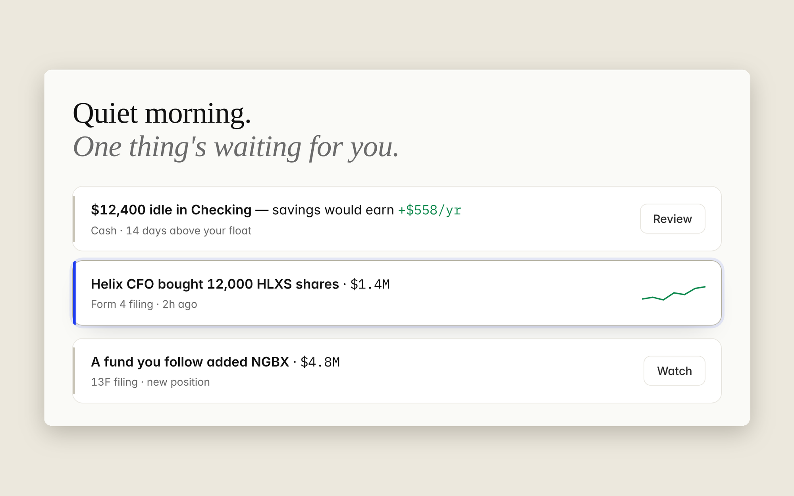
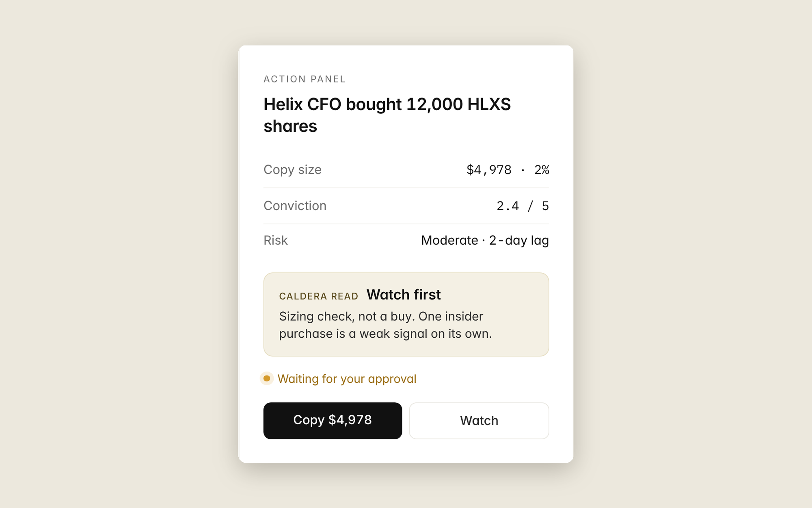

> **Status:** design and spec complete, React build in progress. All data, people and tickers are fictional.

## The problem

Every money app I've used is a mirror. It shows my net worth and spending, then leaves me to work out what to do about it. People who follow insider and fund filings have the same problem: the data is public, but it's scattered and hard to judge.

Caldera asks a simple question: what if one screen ranked your money and those outside signals by what deserves your attention first? I studied Mercury, Stripe, Ramp, Linear and Wealthfront for how they handle calm, density and restraint, then built a design language around that.

## What I designed

**A ranked feed.** Money cards (idle cash, balance alerts) and investing cards (new filings) share one list, each with a one-line plain-English title. The most important thing is always on top.

**An Action Panel that stays put.** Selecting a card fills a panel on the right instead of opening a modal, so you can move through the feed without losing your place. The decision details (size, conviction, risk) are always visible; the reasoning stays collapsed until you ask.

**Caldera Read.** One reusable component for every AI judgment in the product, always in three parts: a calibrated label ("Watch first"), what it is and isn't ("Sizing check, not a buy"), and a disclaimer that never changes. Wording that implies certainty, like "buy now," isn't allowed.

## Decisions that matter

- **One `Money` component for every figure.** Monospaced digits and one set of rounding rules, so numbers line up everywhere.
- **Five colors, one meaning each.** Green for gain, red for loss, blue for action, amber for "waiting on you," gray for everything else.
- **Nothing executes without approval.** Copying a trade or moving cash always stops at "Waiting for your approval."
- **AI wording is deterministic.** The same signal reads the same way all day, so the server and browser render identical text and nothing flickers.

## Delight, kept quiet

- The greeting reads the situation: "Quiet morning. One thing's waiting," or "Caught up. Nothing needs you right now."
- Selecting a card lifts it slightly with a single blue edge pulse.
- Numbers count up once on first load, with fixed-width digits so nothing shifts.

Every animation turns off for people who have reduced motion enabled.

## What's next

- Ship the Home screen as a live React and TypeScript demo with sample data.
- Test the approval flow, and whether deeper reasoning ever needs more room than the panel.
